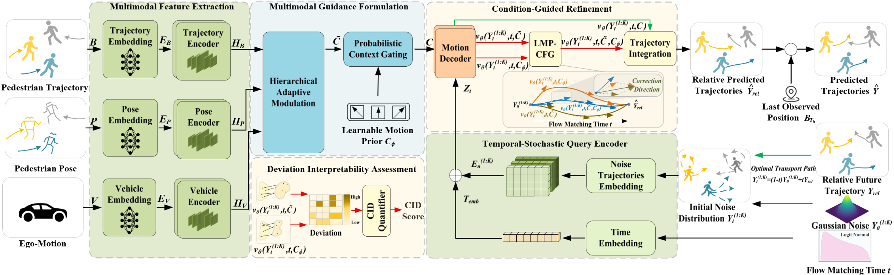

# HM-FMT: Hierarchical Modulation Flow Matching Transformer for Egocentric Pedestrian Trajectory Prediction

This repository hosts the official implementation resources for the manuscript:

> **HM-FMT: Hierarchical Modulation Flow Matching Transformer for Egocentric Pedestrian Trajectory Prediction**

---

## Overview

Egocentric pedestrian trajectory prediction from vehicle-mounted cameras is critical for autonomous vehicle planning and collision avoidance. Unlike bird's-eye-view prediction, this task jointly accounts for pedestrian motion, ego-vehicle motion, and pedestrian intention. Existing flat fusion methods inadequately capture the semantic hierarchy across modalities, leading to feature interference.

To address these challenges, we propose **HM-FMT**, a **Hierarchical Modulation Flow Matching Transformer**:

- **Hierarchical Adaptive Modulation (AMU):** Cascaded modulation units progressively integrate ego-vehicle motion, pedestrian pose, and historical bounding-box trajectories following their physical causal order—ego-vehicle motion first conditions pedestrian pose, and the resulting pose representation then conditions the historical trajectory.
- **Learnable Motion Prior Classifier-Free Guidance (LMP-CFG):** Replaces fixed null tokens with a learnable motion-prior representation jointly optimized in relative-displacement space, providing a stable unconditional baseline and improving the flexibility and robustness of flow-matching guidance.
- **Conditional-Induced Deviation (CID) Score:** Quantifies scene-induced deviations between conditional and unconditional velocity fields during ODE integration without requiring future ground truth, enabling model-intrinsic interpretability of how multimodal scene context influences trajectory generation.

<p align="center">
  
</p>

## Requirements

- Python >= 3.8
- PyTorch >= 1.8
- NumPy
- OpenCV (`opencv-python`)
- Pillow (`PIL`)
- Matplotlib
- scikit-learn

Install the basic dependencies via pip:

```bash
pip install torch numpy opencv-python pillow matplotlib scikit-learn coloredlogs wandb
```

---

## Dataset Preparation

We evaluate HM-FMT on two public egocentric autonomous driving benchmarks:

1. **JAAD (Joint Attention for Autonomous Driving)**
   - Download the dataset videos and annotations from the [official JAAD repository](https://github.com/ykotseruba/JAAD).
   - Extract video clips into frame images or use `datasets/JAAD_origin.py` to parse annotations and generate trajectory sequences.
2. **PIE (Pedestrian Intention Estimation)**
   - Download the dataset from the [official PIE repository](https://github.com/aras62/PIE).

---

## Release Status

- We will release the code later. Stay tuned!
